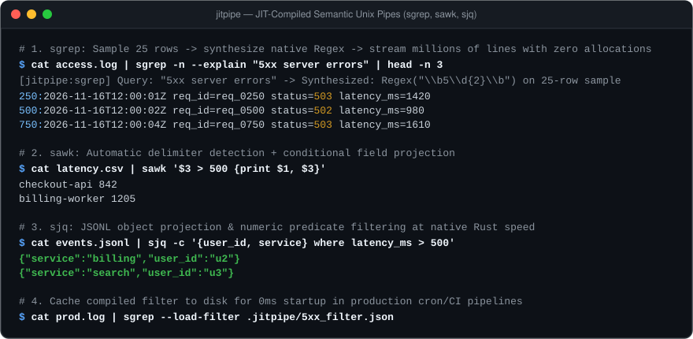

# jitpipe

Sample-driven compiled Unix pipes (`sgrep`, `sawk`, `sjq`) that synthesize a deterministic filter on initial `stdin` rows and stream the rest in native Rust.

[](https://github.com/abhinavm-web/jitpipe/actions/workflows/ci.yml)
[](https://github.com/abhinavm-web/jitpipe/releases)
[](LICENSE)
[](Cargo.toml)

<p align="center">
  
</p>

## Overview

Piping large log or JSONL files line-by-line through an LLM is too slow and expensive for everyday shell pipelines, while embedding-only search cannot evaluate exact numeric predicates or project structured fields.

`jitpipe` splits pipeline execution into two phases across four binaries (`jitpipe`, `sgrep`, `sawk`, `sjq`):

1. **Sample (`~25 rows` + rare-event lookahead)**: Buffers initial lines from `stdin` (terminating immediately on short streams). If none of the first 25 rows match query tokens, `StreamSampler` scans ahead up to 2,000 lines (losslessly buffering every scanned row for sequential uncorking) before synthesis.
2. **Synthesize and verify**: Compiles a deterministic `Regex`, column/predicate `AwkFilter`, or JSON `JqFilter` (using an LLM API with 1-step sample-feedback retry when configured, or offline heuristics) and validates it against the sampled rows.
3. **Uncork and stream**: Replays buffered lines in order and streams remaining rows through a single reused buffer and 128 KB `BufWriter`, handling `SIGPIPE` / Windows broken-pipe errors (`109`/`232`) cleanly with exit code `0`.

```text
  stdin (millions of rows)
         |
         +--> [1] Sample (~25 rows + lookahead) --> Synthesize & verify deterministic filter
         |                                                       |
         v                                                       v
  [2] Uncork sample + remainder ----------------> Native Rust Streaming Engine
                                                                 |
                                                                 v
                                                          stdout (Unix pipe)
```

## Installation

Install all four prebuilt binaries (`jitpipe`, `sgrep`, `sawk`, `sjq`), download an archive from [GitHub Releases](https://github.com/abhinavm-web/jitpipe/releases/latest), or build from source:

```bash
# macOS (Apple Silicon) and Linux (x86_64)
curl -fsSL https://raw.githubusercontent.com/abhinavm-web/jitpipe/main/install.sh | sh
```

```powershell
# Windows (PowerShell)
irm https://raw.githubusercontent.com/abhinavm-web/jitpipe/main/install.ps1 | iex
```

From source:

```bash
git clone https://github.com/abhinavm-web/jitpipe.git
cd jitpipe
cargo run --example showcase
cargo install --path .
```

Installed binaries:
- `sgrep`: line filter compiling to `regex::Regex`
- `sawk`: delimiter-aware column extractor and predicate filter
- `sjq`: JSONL field projector, dot-path extractor, and predicate filter
- `jitpipe`: unified CLI dispatcher (`jitpipe sgrep`, `jitpipe sawk`, `jitpipe sjq`)

## Usage

### `sgrep`

```bash
cat access.log | sgrep "5xx server errors"
cat app.log | sgrep -n -m 100 "timeout or connection reset"
cat access.log | sgrep --explain "failed auth requests"
```

### `sawk`

```bash
cat metrics.log | sawk '{print $1, $NF}'
cat latency.csv | sawk -F, '$3 > 500 {print $1, $3}'
```

### `sjq`

```bash
cat events.jsonl | sjq '{user_id, latency_ms}'
cat events.jsonl | sjq -r '.service where latency_ms >= 250'
cat mixed.jsonl | sjq --ignore-malformed '.items[]'
```

### Filter caching (`--save-filter` / `--load-filter`)

```bash
cat sample.log | sgrep --save-filter .jitpipe/errors.json "database deadlock or timeout"
cat prod-10gb.log | sgrep --load-filter .jitpipe/errors.json
```

### Optional LLM synthesis environment variables

When no API key is set (or `--heuristic` is passed), `jitpipe` uses offline rule synthesis:

- `OPENAI_API_KEY` / `ANTHROPIC_API_KEY`: Enables LLM synthesis on sampled rows with automatic sample-feedback retry on zero matches.
- `JITPIPE_LLM_URL` / `JITPIPE_MODEL`: Custom OpenAI-compatible endpoint and model (e.g., local Ollama at `http://127.0.0.1:11434/v1/chat/completions`).

## Benchmarks

Reproduce locally:

```bash
cargo run --release --example benchmark
```

| Workload | Rows | Throughput | Bandwidth | Precision | Recall |
| :--- | ---: | ---: | ---: | ---: | ---: |
| `sgrep`: 100k mixed access log (`status=5xx`) | 100,000 | 5,350.7k lines/s | 346.6 MB/s | 100.0% | 100.0% |
| `sgrep`: Late rare event (`gateway_timeout` at row 1,250) | 50,000 | 15,759.9k lines/s | 989.2 MB/s | 100.0% | 100.0% |
| `sjq`: 50k JSONL projection + numeric predicate | 50,000 | 1,548.5k lines/s | 79.5 MB/s | 100.0% | 100.0% |

## Architecture

```text
src/
├── lib.rs              # Pipeline runners (run_sgrep, run_sawk, run_sjq)
├── main.rs             # Unified `jitpipe` binary entry point
├── bin/
│   ├── sgrep.rs        # Standalone `sgrep` binary
│   ├── sawk.rs         # Standalone `sawk` binary
│   └── sjq.rs          # Standalone `sjq` binary
├── cli.rs              # Clap argument definitions for all 4 binaries
├── sampler.rs          # N-row stream sampler, rare-event lookahead, and uncorker
├── filter/
│   ├── grep.rs         # Zero-copy Cow<'a, str> regex matcher
│   ├── awk.rs          # Delimiter splitter, $1..$NF template projector, and predicates
│   └── jq.rs           # JSONL dot-path, object projection, array unrolling, and predicates
├── synth/
│   ├── heuristic.rs    # Offline pattern, delimiter, and schema synthesizer
│   ├── llm.rs          # HTTP LLM synthesizer with sample self-verification and fallback
│   ├── cache.rs        # JSON filter serialization (--save-filter / --load-filter)
│   └── mock.rs         # Deterministic synthesizer for tests
└── engine/
    ├── streamer.rs     # Single-buffer remainder streaming engine
    └── pipe.rs         # Cross-platform SIGPIPE / Windows broken-pipe (109/232) handler
```

## Development

```bash
cargo test
cargo clippy --all-targets -- -D warnings
```

## See Also

| Repository | Description |
| :--- | :--- |
| **[agent-fork](https://github.com/abhinavm-web/agent-fork)** | Workspace checkpointing, rewind, parallel worktrees, and cassette recording |
| **[ctx-firewall](https://github.com/abhinavm-web/ctx-firewall)** | Active LLM context proxy and terminal profiler with KV-cache prefix pinning |
| **[diffmem](https://github.com/abhinavm-web/diffmem)** | Git diff-of-diffs episodic memory daemon and editor rule sync |
| **[reddiff](https://github.com/abhinavm-web/reddiff)** | Differential regression finder that emits runnable crash reproducers only |

## License

[MIT](LICENSE)
